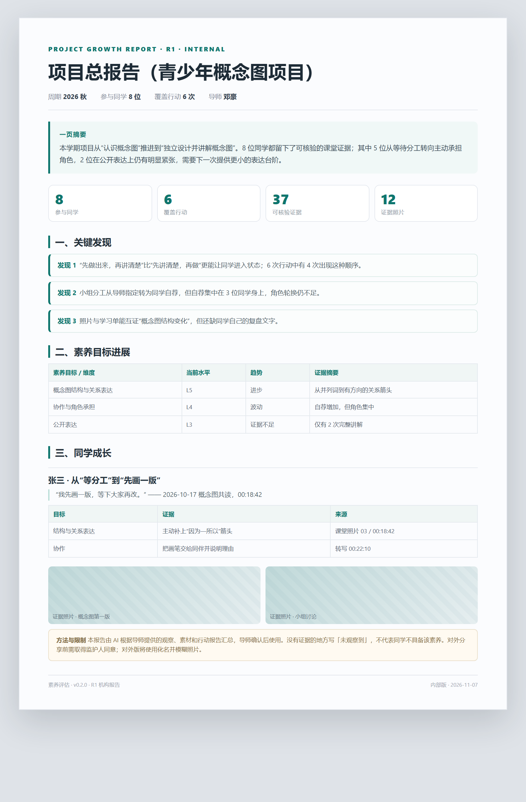

# Literacy Teacher Workbench

A local-first Obsidian plugin for project-based literacy assessment. Educators collect classroom materials, recordings, photos, and observation notes in a project → action structure. The plugin transcribes audio, describes images, extracts evidence, and produces evidence-linked action reports, per-student project reports, project overviews, and term reports.

It also generates an internal version and a redacted external version of every report. The external version replaces student names with aliases and blurs photos.

## 中文说明

面向一线教育者的**本地素养评估工作台**：把一次项目 / 课堂 / 活动的素材收进本地文件夹，由 AI 整理（录音转写、照片说明），生成**行动成长报告**；按项目生成单同学项目报告与**项目总报告**；按学期/学年生成单同学阶段报告与**学期/学年总报告**。每份报告同时生成内部版和对外脱敏版。

### Install

Download `main.js`, `manifest.json`, and `styles.css` from the matching GitHub Release, place them in:

```text
<vault>/.obsidian/plugins/literacy-assessment/
```

Then enable **Literacy Teacher Workbench** in Obsidian's community plugins settings. BRAT users can add `PBL-EDU/literacy-assessment`.

### Network and privacy

The plugin has no server and no telemetry. It contacts only the AI provider and GetNote OpenAPI that the user explicitly configures, using the user's own API keys. Materials and reports stay in the local vault. A confirmation dialog is shown before any AI upload. No automatic updates.

### License

Released under the **GNU Affero General Public License v3.0 (AGPL-3.0-only)**. You may use, modify, and distribute it, including commercially, provided you comply with the AGPL. A separate commercial license is available for organizations that cannot accept the AGPL obligations. See [LICENSE](LICENSE) and [LICENSE-COMMERCIAL.md](LICENSE-COMMERCIAL.md).

- 插件 id：`literacy-assessment`
- 版本：`0.2.7`
- 形态：Obsidian 桌面端插件；数据全部在本地库；AI 通过 OpenAI 兼容接口调用，导师自带 Key
- 不引入 ffmpeg / 本地模型 / 常驻服务
- 授权：个人导师免费使用；机构部署/商用需书面授权（见 [LICENSE](LICENSE)）
- 许可证：**AGPL-3.0**；可自由使用/修改/分发（含商业用途），但需遵守 AGPL 的源码与网络使用条款；不接受 AGPL 的机构可购买商业授权（见 [LICENSE](LICENSE) 与 [LICENSE-COMMERCIAL.md](LICENSE-COMMERCIAL.md)）
- 网络：只有导师主动调用 AI 或得到 OpenAPI 时才联网，使用导师自己配置的 Key；无遥测、无自动更新
- 数据：素材与报告默认保存在本地库；仓库不包含任何真实学生数据或 API Key



## 第一版范围

1. 收集非结构化素材：学习单、作品、学生复盘（录音/文字）、导师评估（录音/文字）、导师复盘（录音/文字）、课堂照片/录音/视频。
2. 按「项目 → 行动」归集到 `01_项目/<项目>/行动/日期_名称/`（旧库 `01_系列` 仍可读）。
3. AI 整理：录音/视频转文字（带时间戳），照片/学习单写观察说明，视频抽 3 个关键帧写画面说明。
4. 对照本次教学目标，生成**行动成长报告**（证据 + 报告，标题和文件名含项目/行动）。
5. 按项目生成单同学项目报告与项目总报告；按学期/学年生成单同学阶段报告与机构总报告。
6. 每份报告同时生成内部版与对外版（化名、照片模糊）。

## 已实现

| 能力 | 入口 |
| --- | --- |
| 新建项目（课程/活动群） | 侧栏「行动」组「新建项目」/ 命令面板 |
| 新建小组（固定成员） | 侧栏「人」组「新建小组」/ 命令面板 |
| 新建同学 | 侧栏「人」组「新建同学」/ 命令面板 |
| 新建行动（项目/课程/课堂/活动/行动） | 侧栏「行动」组「新建行动」/ 命令面板 |
| 项目下多次行动 | 新建行动时选「归属项目」 |
| 得到大脑录音同步（暂存 → 匹配已有行动） | 侧栏「同步得到」/ 命令面板 |
| 得到导入总目录（每条笔记存放/归口位置） | 侧栏「查看导入」/ `05_导入/得到/00_得到导入总目录.md` |
| 扫描素材、生成素材清单 | 侧栏「扫描」/ 右键行动笔记 |
| 录音/视频转写（OpenAI 兼容 ASR） | 侧栏「AI 整理」 |
| 照片/学习单图像说明（视觉模型） | 侧栏「AI 整理」 |
| 视频关键帧说明（抽 3 帧，best effort） | 侧栏「AI 整理」 |
| 学习目标证据抽取（JSON） | 侧栏「生成报告」 |
| 行动成长报告（项目 · 行动） | 侧栏「生成报告」 |
| 单同学项目报告 | 项目标题旁「项目报告」/ 命令面板 |
| 项目总报告（项目内全部同学） | 项目标题旁「项目总览」 |
| 单同学学期/学年报告 | 命令面板「生成阶段性成长报告」 |
| 学期/学年总报告（全部项目/同学） | 侧栏「管理」组「学期总报告」/ 命令面板 |
| 内部 / 对外两版 | 生成报告时自动生成 `_对外.md`，化名 + 模糊照片 |
| 自动双链 | 行动 ↔ 项目 / 小组 / 同学 / 框架；正文首次提及自动内链，底部另有「关联」索引 |
| 图像说明附原图 | `转写/图像说明.md` 每个说明块内嵌原图，便于核对 |
| 报告证据照片 | 自动带出 `素材/` 照片，AI 可引用 |
| 报告导出 PDF | 报告卡片「PDF」/ 命令面板 / 文件右键 |
| 发送前隐私确认 | 默认开启 |
| 报告证据来源（文件 + 时间戳）与免责声明 | 自动写入报告 |

## 安装 / 构建

```bash
npm install
npm run build
```

把 `main.js`、`manifest.json`、`styles.css` 放进：

```
<你的库>/.obsidian/plugins/literacy-assessment/
```

或直接运行安装脚本：

```powershell
.\install.ps1 -VaultPath "D:\我的Obsidian库"
```

在 Obsidian 设置 → 第三方插件里启用「素养评估」。

想先试一下：从 [GitHub Releases](https://github.com/PBL-EDU/literacy-assessment/releases/tag/0.2.7) 下载 `main.js`、`manifest.json`、`styles.css`，放入插件目录；或使用 zip 安装包。不要把测试用的学生素材库提交到本仓库。

BRAT 用户添加仓库 `PBL-EDU/literacy-assessment`，选择 `0.2.7` 即可。

## 快速上手

1. 设置 → 素养评估：填 AI 服务、转写服务；点「测试连接」。
2. 设置 → 得到大脑：填 API Key / Client ID（需得到大脑会员）。
3. 侧栏「素养评估」→ 新建项目（可选）→ 新建小组/同学（可选）→ 新建行动：归属项目默认「暂不归属」（之后可补），勾选小组/同学、勾选/新增教学目标。
4. 用得到录音卡/录音台录课；侧栏点「同步得到」，先暂存到 `05_导入/得到/`，再按时间 + 内容匹配到**已有行动**；匹配成功只把转写/总结拷贝到该行动 `素材/`，原始录音始终留在得到暂存区。未匹配继续留在暂存区。
5. 再点「扫描」→「AI 整理」→「生成报告」（单次行动，自动带证据照片）。
6. 同一项目的多次行动，点项目标题旁「项目报告」；按学员/时间的阶段报告在命令面板；报告可导出 PDF。

详细说明见 [使用指南](docs/使用指南.md)。

## 数据目录

```
白日梦行动/
  00_框架/素养框架.md
  01_项目/<项目>/              # 新目录；旧库 01_系列 兼容
    <项目名>.md
    行动/<日期_名称>/
      <行动名>.md
      素材/ 观察/ 转写/ 证据/ 报告/
  02_小组/<小组>/
    <小组名>.md
  03_学员/<同学>/
    <姓名>.md
  04_模板/
  05_导入/
    得到/
      00_得到导入总目录.md     # 每次导入/归口的汇总目录
      <日期_标题>/              # 得到笔记暂存区；转写/总结匹配成功后拷贝，原录音保留
  06_报告/                       # 学期/学年总报告
    学期总报告_<周期>.md
    学期总报告_<周期>_对外.md
```

- 卡片文件名就是实体名称（`社区小店调研项目.md`、`社区小店调研.md`、`小店探索组.md`、`张三.md`），全库唯一。
- 重名时自动加后缀（如 `社区小店调研（社区小店调研项目）.md`），显示标题不变，双链仍指向正确文件。

## 开发

```bash
npm run dev        # watch
npm run build      # production bundle
npm run typecheck
npm test             # 25 项纯逻辑单测
npm run test:asr     # 本地 mock 服务验证 multipart / 中文文件名 / 25 MB 拦截
npm run test:getnote # 本地 mock 验证得到列表/详情/鉴权头
npm run test:smoke   # 用 mock 的 obsidian 模块加载 main.js
```

## 状态

- `typecheck`、`build`、25 项单测、bundle 冒烟测试已通过。
- **尚未在 Obsidian 真机 + 真实 API Key 下跑通一次完整活动**；ASR/视觉/文本模型与得到 OpenAPI 的兼容性需要用小样本校准。
- 已知限制：语音转写需要单独配置（文本 Key 不能转写）；OpenAI 转写单文件上限 25 MB，长录音需压缩/切分或用现成转写文字；PDF/Word 未自动解析；视频会抽 3 个关键帧，但编码不被 Electron 支持时只保留音轨转写；图像需要视觉模型（deepseek-chat 不能看图）；没有证据人工复核界面；没有内容 hash 缓存与成本预估；没有公开网站/机构报告。

## 授权与商用

- **个人导师**：免费下载、免费使用；数据保存在本地，模型 API Key 与费用由导师自行解决。
- **机构/商业使用**：部署给 2 位及以上导师、作为机构评估系统、对外收费服务、白标/OEM、机构级聚合与合规支持，需要取得白日梦项目组的书面授权。
- 插件不提供大模型 API，不代收模型费用，不收取/存储导师的原始素材与报告（除非主动提交或另行签约）。
- 完整条款见 [LICENSE](LICENSE)；机构合作通过 PBL-EDU 项目渠道联系。

## 文档

- [需求列表](docs/需求列表.md)
- [架构说明](docs/架构说明.md)
- [使用指南](docs/使用指南.md)
- [0.2.7 UI 与报告设计](docs/UI与报告设计-0.2.7.md)
- [变更记录](CHANGELOG.md)
- [发布到 GitHub 与 Obsidian 市场](docs/发布到GitHub与Obsidian市场.md)
- [得到大脑录音接入](docs/得到接入.md)
- [国内 AI 服务商清单](docs/国内AI服务商清单.md)
- [机构授权协议模板](docs/机构授权协议模板.md)
- [数据委托处理协议（DPA）模板](docs/数据委托处理协议（DPA）模板.md)


## 隐私

插件没有服务器、没有遥测。只有导师主动运行 AI 时，素材才从本机直连所配置的 AI 服务；发送前默认弹窗确认。对外分享报告前，请单独取得监护人/机构同意并做脱敏。


