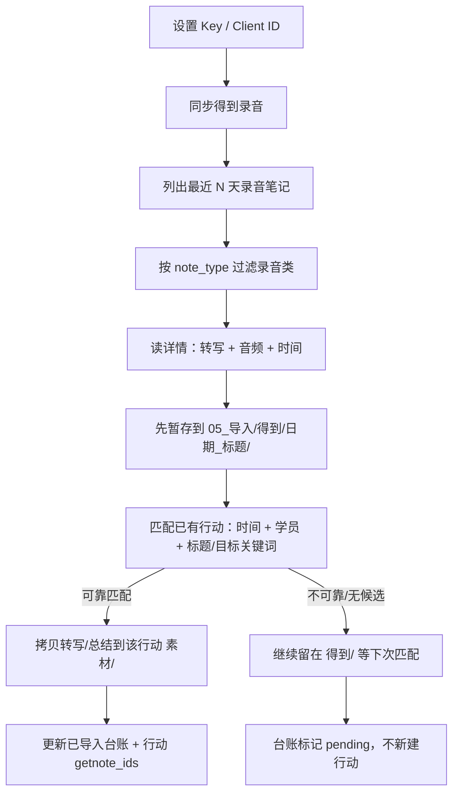

# 得到大脑录音接入

> 目标：把得到大脑（Get笔记）作为课堂录音的主要采集工具；插件通过 OpenAPI 拉取录音笔记、转写和音频，按**录音时间 + 内容**匹配到行动文件夹。
> 官方开放平台：<https://www.biji.com/openapi>｜参考客户端：<https://github.com/iswalle/getnote-mcp>

## 一、前置条件

1. **得到大脑会员**：OpenAPI 仅对会员开放；没有会员会返回鉴权/权限错误。
2. 在开放平台创建应用，拿到：
   - **API Key**（`gk_live_...`）
   - **Client ID**（`cli_...`）
3. 在插件 设置 → 素养评估 → 得到大脑 填入 Key / Client ID；点「测试得到连接」。
4. 录音设备：
   - **GetSeed 录音卡**：来源 `getseed`，长录音类型 `recorder_audio`，闪念 `recorder_flash_audio`。
   - **得到录音台 / MOAN**：来源 `vendor_moan`。
   - 不确定就选「全部」，插件会按录音类型过滤。

## 二、插件调用的接口

Base URL：`https://openapi.biji.com/open/api/v1`

请求头：

```
Authorization: Bearer <API Key>
X-Client-ID: <Client ID>
Accept: application/json
```

### 2.1 列出录音笔记

```http
GET /resource/note/list
  ?created_from=<RFC3339>
  &created_to=<RFC3339>
  &page_size=50
  &cursor=<next_cursor>
  &source=<getseed|vendor_moan|dedao>
```

- `created_from` 包含、`created_to` 不包含；插件默认拉最近 7 天。
- 返回 `data.notes[]`，每条含 `id`、`note_id`、`title`、`note_type`、`source`、`created_at`。
- **ID 精度**：`id` 是 19 位整数，超过 JavaScript 安全整数范围；插件统一使用字符串 `note_id` 作详情请求和台账。否则尾数会被四舍五入，出现「列表读取成功、详情全部失败」。
- 分页用 `data.pagination.next_cursor`；插件最多翻 20 页，避免失控。

### 2.2 读详情 / 转写 / 附件

```http
GET /resource/note/detail?id=<note_id>
```

关键字段：

| 字段 | 用途 |
| --- | --- |
| `note.title` | 标题 |
| `note.created_at` | 录音/笔记时间，用于时间匹配 |
| `note.audio.original` | 逐字转写原文（**不是 AI 总结**） |
| `note.audio.play_url` | 音频地址，用于下载 |
| `note.audio.duration` | 时长（秒） |
| `note.attachments[]` | 图片/音频/文件附件（含 `url`、`type`、`size`、`duration`） |
| `note.content` | AI 总结/正文；只作为辅助，不作为逐字证据 |

插件只读，不修改得到笔记。

## 三、导入流程



### 3.1 先暂存，再移动

**第一步：暂存到** `05_导入/得到/<日期_标题>/`：

| 内容 | 路径 |
| --- | --- |
| 逐字转写 | `得到转写_<标题>.md` |
| 得到 AI 总结 | `得到总结_<标题>.md`（仅辅助，不作为逐字证据） |
| 原始音频 | `得到录音_<标题>.<扩展名>`（可在设置关闭） |
| 笔记信息 | `笔记信息_<标题>.md`（含 `getnote_id`、状态 pending） |

**第二步：可靠匹配到** `01_项目/<项目>/行动/<行动>/`（旧库 `01_系列` 兼容）**后**，只**拷贝**两个文本文件到该行动的 `素材/`：

| 内容 | 拷贝后路径 | 暂存区原件 |
| --- | --- | --- |
| 逐字转写 | `素材/得到转写_<标题>.md` | 保留 |
| AI 总结 | `素材/得到总结_<标题>.md` | 保留 |
| 原始录音 | **不拷贝、不移动** | 保留在 `得到/` |
| 笔记信息 | **不拷贝、不移动** | 保留在 `得到/` |
| 防重复台账 | `05_导入/得到/已导入.json`（status=imported） | — |
| 行动外键 | `<行动名>.md` frontmatter 的 `getnote_ids` | — |

匹配不上时，文件**原样留在** `05_导入/得到/`，台账标记 `pending`，下次同步继续尝试匹配。

防重复：台账以 `note_id` 为键；`imported` 直接跳过，`pending` 优先复用已有暂存文件夹（并按 `笔记信息.md` 里的 `getnote_id` 找回），不会重复建暂存目录；同步进行中再次点击会被锁住。

每次同步结束都会重写 `05_导入/得到/00_得到导入总目录.md`，列出：得到笔记 ID/标题、录音时间、状态（已归口/待匹配）、暂存或 `素材/` 位置、归属系列、归属行动；侧栏「导入目录」可直接打开。

### 3.2 匹配规则

1. **时间**：
   - 行动填了 `start_time`/`end_time`：录音时间窗与行动时间窗重叠 → 高分；同一天 → 中分；相邻日 → 低分。
   - 行动没填时间：同一天 → 中分；相邻日 → 低分。
2. **内容**：
   - 转写/标题提到学员姓名：每个 +3；
   - 提到行动标题关键词：每个 +1.5（最多按标题词计）；
   - 提到所属系列名，或与系列名有 ≥3 字共同片段：按共同片段加分（如「概念图项目商讨」与「青少年概念图项目」）；
   - 提到教学目标关键词：每个 +0.5；
   - 正文提到完整行动名称：+3。
3. **判定**：
   - 最高分 ≥ 6，且比第二名高 ≥ 2 → 可靠匹配，拷贝转写/总结到该行动 `素材/`；
   - 只有一个候选且 ≥ 4 → 按唯一候选；
   - 否则 → **不新建行动**，文件继续留在 `05_导入/得到/`，等导师补行动信息后再次同步。
4. **为什么宁肯暂存也不乱放**：放错文件夹会污染另一个孩子的报告；暂存区可以人工核对后再匹配。

## 四、限制与边界

- 只覆盖已经同步成得到笔记的录音；设备未同步/未形成笔记的会议不在 API 里。
- 得到 API 的音频地址可能过期，插件在同步时立即下载；失败会保留转写并提示。
- 逐字转写可能有错字；报告引用前请导师核对原音。
- 长录音/大文件受得到 API 与网络限制；插件会记录失败，不阻塞其他笔记。
- 没有转写的笔记仍会暂存（含总结/音频/笔记信息），但匹配证据不足时留在暂存区；不把 AI 总结冒充逐字稿。
- 同步只读；不会删除、修改得到笔记。
- API Key/Client ID 保存在本地插件 `data.json`，不上传白日梦服务器；不要把带 Key 的库发给别人。

## 五、操作步骤

1. 设置 → 素养评估 → 得到大脑：填 API Key、Client ID，选来源，点「测试得到连接」。
2. **先建好行动**：填 **日期 + 开始/结束时间 + 参与学员 + 教学目标**；同一系列的填「归属系列」。没有行动时，同步不会替你新建，录音会留在得到暂存区。
3. 课堂用得到录音卡/录音台录制，等待得到生成笔记。
4. 插件侧栏点「同步得到」；插件会先暂存到 `05_导入/得到/`，再尝试匹配已有行动。
5. 匹配成功 → 打开该行动，检查 `素材/` 里新增的转写/总结；原始录音仍在 `05_导入/得到/`。未匹配 → 在 `05_导入/得到/` 里查看，补好行动信息后再次同步。
6. 运行「AI 整理」和「生成报告」。

## 六、常见错误

| 现象 | 检查 |
| --- | --- |
| 401/403 | API Key / Client ID 是否正确；得到大脑会员是否开通 |
| 没有返回录音 | 来源筛选是否选错；录音是否已同步成得到笔记；时间范围是否太窄 |
| 没有转写 | 得到笔记是否还在转写中；稍后重试；或检查 `note.audio.original` |
| 一直留在 得到/ | 还没有对应行动，或时间/学员/标题/目标匹配不够；先建行动或补全行动信息，再同步 |
| 匹配到错误行动 | 给行动补 `start_time/end_time`；把学员姓名写进 participants；或在同步后手动移动 |
| 音频下载失败 | 地址是否过期；网络；文件是否过大 |
| 重复导入 | 检查 `05_导入/得到/已导入.json` 和行动 `getnote_ids`；删掉对应条目可重试 |

> 本接入依赖得到大脑 OpenAPI；接口字段/权限/会员政策以官方文档与控制台为准。
