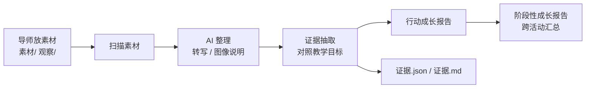
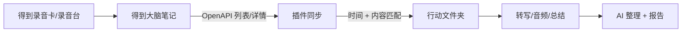

# 素养评估系统 · 架构说明

## 一、定位

面向一线教育者的**本地素养评估工作台**：导师把项目/课堂/行动的素材放进本地文件夹，插件调用 AI 做整理与证据抽取，生成行动、项目与学期报告；每份报告同时生成内部版与对外脱敏版。

**不是**：学生端 App、机构管理系统、公开分享平台、自动评分系统。

## 二、设计原则

1. **本地优先**：原始素材、转写、证据、报告都在导师的 Obsidian 库里；插件不设服务器、不做遥测。
2. **证据驱动**：每条结论要能回到「文件名 + 时间戳/画面」；没有证据写「未观察到」，不写「不具备」。
3. **人机分工**：AI 只产出证据候选与草稿；等级判断、报告确认、对外使用由导师负责。
4. **固定骨架**：活动报告、阶段报告结构固定，AI 不自由发挥；结构稳定才能跨活动比较。
5. **最小依赖**：只用 Obsidian + 云端 AI API；不引入 ffmpeg、本地模型、Python 服务。

## 三、数据流



## 四、目录结构

```
白日梦行动/
  00_框架/
    素养框架.md                 # 标准素养目标，报告会读
  01_项目/
    社区小店调研项目/
      社区小店调研项目.md       # 系列名称/类型/目标/简介
      行动/
        2026-11-06_社区小店调研/
          社区小店调研.md       # 行动元信息 + 教学目标 + 导师记录
          素材/                 # 学习单、作品、录音、视频、照片
          观察/                 # 导师复盘、学习故事（md/txt）
          转写/                 # 转写、图像说明（生成）
          证据/                 # 证据.json / 证据.md（生成）
          报告/                 # 行动成长报告（项目 · 行动）.md（生成）
          素材清单.md           # 扫描结果（生成）
  02_小组/
    小店探索组/
      小店探索组.md             # 固定成员、所属系列
  03_学员/
    张三/
      张三.md                   # 档案、alias、个性化目标、报告链接
      项目成长报告_*.md          # 生成
      阶段成长报告_*.md          # 生成
  04_模板/
    活动报告模板.md
  05_导入/
    得到/
      00_得到导入总目录.md
      已导入.json
  06_报告/
    学期总报告_<周期>.md
    学期总报告_<周期>_对外.md
```

- **文件名即实体名，全库唯一**：`<系列名>.md` / `<行动名>.md` / `<小组名>.md` / `<姓名>.md`；重名自动加后缀，显示标题不变。旧库可运行「规范化实体文件名（旧库迁移）」。
- **一次行动是最小颗粒度**；行动落在某个系列的 `行动/` 子文件夹；未选系列时默认放到 `01_项目/暂不归属/行动/`，不生成系列卡片，之后可补系列。
- 小组是“学员之上”的固定参与单位；行动可勾选一个或多个小组，成员自动并入 participants。
- 兼容旧版 `01_行动/` 与旧项目目录 `01_系列/`：只读识别；新建一律进 `01_项目`。

- 所有路径都相对 Obsidian 库根目录；`数据根目录` 可在设置里改。
- 原始视频建议放在库外或 Obsidian 的「排除文件」里，避免同步/索引变慢；`0.1` 默认仍读 `素材/`，导师可自行调整。

## 五、核心对象

| 对象 | 位置 | 说明 |
| --- | --- | --- |
| Series | `01_项目/<项目>/<项目名>.md` | 项目名称/类型/导师/教学目标/简介 |
| Group | `02_小组/<小组>/<小组名>.md` | 小组固定成员、所属项目 |
| Action | `01_项目/<项目>/行动/<行动>/<行动名>.md` frontmatter | 行动名、类型、日期、开始/结束时间、导师、参与者、小组、教学目标、框架路径、状态、项目/序号、得到笔记 ID |
| GetNote ledger | `05_导入/得到/已导入.json` | 已同步的得到笔记 ID，防重复 |
| Artifact | `素材/` | 原始素材；扫描时按扩展名分类，生成 `素材清单.md` |
| Transcript | `转写/<文件名>.md` | 带时间戳的转写；图像说明汇总在 `转写/图像说明.md`，每个说明块附 `![[原图]]` 佐证 |
| Evidence | `证据/证据.json` + `证据.md` | 逐条证据：学员、目标、维度、水平、引文、来源、置信度、原文/推断 |
| ActivityReport | `报告/行动成长报告（项目 · 行动）.md` | 单次行动；含证据照片；内部版 + `_对外.md` |
| ProjectReport | `03_学员/<姓名>/项目成长报告_*.md` | 同项目、单同学成长；内部版 + `_对外.md` |
| ProjectOverview | `01_项目/<项目>/报告/项目总报告_*.md` | 同项目、全部同学 |
| StageReport | `03_学员/<姓名>/阶段成长报告_*.md` | 单同学跨项目/按周期汇总 |
| TermOverview | `06_报告/学期总报告_*.md` | 全部项目/全部同学的周期总报告 |
| External | `*_对外.md` + `对外图片/` | 化名、模糊照片，`visibility: external` |

## 六、AI 调用契约

> 逐字提示词、输入模板与内部商业化讨论不随公开仓库发布；公开能力说明见 README。

### 6.1 文本评估

- 接口：OpenAI 兼容 `POST /chat/completions`。
- 输入：活动元信息、教学目标、素养框架摘录、按优先级截断的素材上下文。
- 输出：严格 JSON；插件用 `extractJson` 解析，解析失败自动重试一次。
- 关键约束写在 system prompt：只使用材料、证据带来源、区分原文/推断、没有证据写「未观察到」、不贴标签。

### 6.2 语音转写

- 接口：OpenAI 兼容 `POST /audio/transcriptions`。
- 传输：桌面端 Node `https` + multipart，避免 CORS 与 `requestUrl` 的 body 限制。
- 支持音频与视频（由服务端抽取音轨）；插件侧上限 100 MB；OpenAI 官方接口另有 25 MB 单文件上限，超过会在本地直接提示。
- 优先请求 `verbose_json` 拿时间戳，网关不支持时降级 `json`。
- 长录音（>25 MB）暂不自动切分；可先压缩，或把「得到大脑」等现成转写文字放进素材。

### 6.3 图像与视频画面理解

- 图片在本地用 canvas 缩放到最长边 1600 px，转 data URL；再以 `image_url` 内容发给视觉模型。
- 视频用 HTML5 `<video>` + canvas 均匀抽 3 个关键帧，一次请求发给视觉模型；不依赖 ffmpeg。
- 单次处理图片张数由 `visionMaxImages` 控制，默认 20；视频关键帧按视频逐个处理。
- HEIC 或 Electron 不支持的视频编码会提示失败，不静默跳过；转写仍保留。

### 6.4 上下文预算

- 默认 60,000 字符；按优先级保留：
  1. `观察/` 导师复盘（最重要）
  2. 行动卡片正文
  3. `转写/` 与图像说明
  4. `素材/` 里的文字学习单
- 超预算时中间截断，并在报告生成时提示「已省略」。

## 七、报告结构

### 行动成长报告

1. 活动概览
2. 教学目标与证据覆盖（表）
3. 学员观察（逐人：概述、证据、优势、下一步、待补证据）
4. 导师建议
5. 整体待补证据
6. 附：证据清单（表）

### 阶段性成长报告

1. 阶段概览
2. 素养目标进展（目标、水平、趋势、证据摘要）
3. 关键证据
4. 优势
5. 下一步建议
6. 待补证据

## 八、隐私与合规

- 插件不设服务器；AI 请求由导师电脑直连所配置的服务。
- 发送前默认弹窗确认，要求勾选「已取得监护人/机构同意」。
- API Key 存在本库插件 `data.json`，不加密；共用电脑需自行管理。
- 报告默认本地保存；对外分享前需单独取得监护人同意并做脱敏。
- 不自动给孩子定级、不生成「素养分数」；避免把 AI 推测当成事实。

## 九、已知限制

1. **真机未验证**：代码通过类型检查、构建与纯逻辑单测，但还没在 Obsidian 里用真实 Key 跑通一次活动。
2. **PDF/Word 未解析**：学习单是 PDF/Word 时需先导出为图片或文字。
3. **视频画面是 best effort**：抽 3 个关键帧；编码不被 Electron 支持时只保留音轨转写；帧数/开关配置待补。
4. **无人工复核界面**：证据目前只能看 Markdown/JSON，复核在 R-015。
5. **无内容 hash 缓存**：改名会重跑；成本预估在 R-011。
6. **上下文截断**：长活动可能丢掉中间素材；报告会提示，导师需抽查。
7. **模型差异**：不同模型对 JSON、时间戳、中文引文的稳定性不同；建议先用小样本校准。

## 十、路线

| 版本 | 内容 |
| --- | --- |
| v0.1（当前） | 单活动闭环 + 阶段报告 + 侧栏 + 隐私确认 |
| v0.2 | 证据复核界面、内容 hash 缓存、成本预估、模板可配置 |
| v0.3 | PDF/Word 解析、视频帧数与开关配置、飞书/录音卡监听 |
| v1.0 | 多导师协作/机构报告需要服务端与权限，另行设计 |

## 十一、国内服务商与兼容性

完整清单见 [国内AI服务商清单](国内AI服务商清单.md)，这里只记技术判断：

| 用途 | 可直接接（OpenAI 兼容） | 需适配（原生接口） |
| --- | --- | --- |
| 语音转写 `/audio/transcriptions` | 硅基流动（SenseVoiceSmall / TeleSpeechASR，50 MB/1 小时，仅文本）；OpenAI Whisper（25 MB，有时间戳） | 阿里云百炼 Qwen-ASR、腾讯云 ASR、讯飞、火山引擎、百度语音 |
| 图像理解 `chat/completions` + `image_url` | 硅基流动、阿里云百炼 Qwen-VL、火山方舟、智谱、Kimi、阶跃、腾讯混元、百度千帆、商汤 | 只接受公网 URL 的视觉接口（当前插件只传 base64） |
| 视频画面 | 本地抽 3 帧后走任意视觉模型 | 原生视频理解 API（v0.1 未接） |

关键约束：

1. **ASR 接口形态**：插件只发 multipart `file` + `model` 到 `/audio/transcriptions`。阿里云 `qwen3-asr-flash` 是 chat + `input_audio`，filetrans 是异步任务，不能直接填。
2. **长录音**：OpenAI 25 MB、硅基流动 1 小时，都覆盖不了 1 小时 39 分的课堂；长音频要用原生接口（阿里云 filetrans 12 小时/2 GB 等），需要适配器，或先用得到大脑/飞书妙记导出文字。
3. **base64**：视觉接口最好支持 `data:image/...;base64,...`；只接受 URL 的需要先上传 OSS/图床，v0.1 未做。
4. **时间戳**：硅基流动 ASR 只返回整段 `text`；需要时间戳用 OpenAI Whisper 或阿里云 filetrans（需适配）。
5. **模型名会变**：以服务商控制台的模型广场为准，文档只给示例。

## 十二、个人版 / 机构版边界与授权

### 12.1 v1 的默认调用方式

```text
Obsidian 插件（导师本地）
   │ 导师/机构自己的模型 API Key
   ▼
大模型供应商
   ▼
插件本地校验 / 渲染 / 保存报告
```

- **不做**服务端提示词代理；插件直接调用导师配置的 OpenAI 兼容接口。
- 提示词随插件分发，可被读取；v1 不把 prompt 当商业秘密，也不做混淆。
- 个人版免费；机构部署/商用需书面授权（见根目录 [LICENSE](../LICENSE)）。
- 机构版的后台只做账号、名单、聚合、报告、合规、培训等“综合服务”，不强制接管模型调用。

### 12.2 个人版与机构版

| | 个人版（免费） | 机构版（授权） |
| --- | --- | --- |
| 用户 | 1 位导师 | 多位导师/多站点 |
| 数据 | 本地 | 机构授权/可选汇总 |
| 模型 | 导师 BYOK | 机构统一 Key / 可选网关 / 私有化 |
| 功能 | 基础 rubric、活动/阶段报告 | 统一目标、跨导师聚合、机构/资助人报告 |
| 管理 | 无 | 账号、权限、审计、配额 |
| 合规 | 导师自负 | DPA、同意模板、保留策略、脱敏 |
| 服务 | 文档/社区 | 培训、校准、实施、优先支持 |
| 集成 | 文件夹 | 飞书/录音卡/SSO/API |

### 12.3 未来可选：机构统一网关

只有机构明确要求“统一模型采购/统一开票/统一风控/数据不出机构”时，才加网关：

```text
插件 → 机构网关（可选）→ 模型
```

- 网关可以部署在机构 VPC，也可以由项目组托管；
- 网关负责鉴权、配额、模型路由、日志与计费；
- 个人版不需要网关；不要为了“保护 prompt”提前做重服务端。

### 12.4 授权与责任

- 个人免费；机构（2 位及以上导师、机构系统、收费服务、白标/OEM）需书面授权。
- 插件不提供模型 API、不代收模型费；数据默认在本地；使用者负责监护人/机构同意与合规。
- AI 报告是草稿，必须导师复核；报告对外使用前脱敏。
- 完整条款见 [LICENSE](../LICENSE)；机构/商业授权通过 PBL-EDU 项目组联系。

## 十三、行动模型与得到接入

### 13.1 系列 → 小组 → 学员 → 行动

- **项目**（`01_项目/<项目>/<项目名>.md`）：项目/课程/活动群；承载项目教学目标；旧库 `01_系列` 兼容。
- **行动**（`01_项目/<项目>/行动/<日期_名称>/`）：最小颗粒度；每次行动记录 `date/start_time/end_time/mentor/participants/groups/goals/series/sequence`。
- **小组**（`02_小组/<小组>/<小组名>.md`）：学员之上的固定参与单位；行动可勾选小组，成员自动并入 participants。
- **学员**（`03_学员/<姓名>/<姓名>.md`）：个人档案与报告。
- `type` 可为：项目 / 课程 / 课堂 / 活动 / 行动 / 其他。
- 报告分三种范围：
  1. 单次行动 → 行动成长报告（`报告/行动成长报告（项目 · 行动）.md`）；
  2. 同项目多次行动 → 单同学项目报告（`03_学员/<姓名>/项目成长报告_<项目>.md`）；
  3. 按学员/时间跨系列 → 阶段性成长报告（`阶段成长报告_<标签>.md`）。

### 13.2 得到大脑接入



- 鉴权：`Authorization: Bearer <API Key>` + `X-Client-ID`；需要得到大脑会员。
- 列表：`GET /resource/note/list`，按 `created_from/to`、`source`、`page_size`、`cursor` 翻页。
- 详情：`GET /resource/note/detail?id=...`，取 `note.audio.original`（逐字转写）、`note.audio.play_url`（音频）、`note.created_at`（时间）。
- 暂存：所有录音笔记先落到 `05_导入/得到/<日期_标题>/`（转写/总结/音频/笔记信息），不直接进行动。
- 总目录：每次同步重写 `05_导入/得到/00_得到导入总目录.md`，显示每条笔记的暂存/归口位置、状态、系列与行动。
- 匹配：时间窗（行动 `start_time/end_time` + 设置窗口）+ 内容关键词（学员、标题、系列、目标）；可靠匹配只把转写/总结**拷贝**到该行动 `素材/`，原始录音/笔记信息继续留在暂存区；匹配不上继续留在暂存区，台账 `pending`，不新建行动。
- 防重复：`05_导入/得到/已导入.json` + 行动 frontmatter `getnote_ids`。
- 只读：不修改得到笔记；API Key 存本地 `data.json`，不经过白日梦服务器。

详细字段、规则、限制见 [得到大脑录音接入](得到接入.md)。

### 13.3 报告范围与操作入口

| 范围 | 入口 | 输出 |
| --- | --- | --- |
| 单次行动 | 侧栏「生成报告」 | `报告/行动成长报告（项目 · 行动）.md` |
| 单同学项目 | 项目标题「项目报告」 | `03_学员/<姓名>/项目成长报告_<项目>.md` |
| 项目总览 | 项目标题「项目总览」 | `01_项目/<项目>/报告/项目总报告_<周期>.md` |
| 单同学学期/学年 | 命令面板「生成阶段性成长报告」 | `03_学员/<姓名>/阶段成长报告_<周期>.md` |
| 学期/学年总报告 | 侧栏「管理 → 学期总报告」 | `06_报告/学期总报告_<周期>.md` |

### 13.4 自动双链

- 行动笔记底部自动生成「关联」区块：系列、小组、学员、框架。
- 系列笔记：关联小组、行动、学员、框架；小组笔记：系列、成员、行动；学员笔记：小组、系列、行动、报告。
- 活动报告：关联行动、系列、小组、学员、框架；系列/阶段报告：关联学员与报告。
- 使用 Obsidian `[[路径|显示名]]`；路径由插件生成，避免同名文件歧义。
- 区块用 `<!-- literacy-links:start/end -->` 包裹，只替换标记内内容；卡片/报告/证据/观察正文中的首次提及会就地插入 `[[路径|名称]]`，跳过 frontmatter、代码块、已有双链、URL 和「关联」区块；`素材/`、`转写/` 原文不改。
- 触发：新建系列/小组/行动、生成报告、同步得到、启动时自动同步；也可命令「同步双链关系」。

### 13.5 证据照片与 PDF

- `素材/` 图片会作为报告附件照片（最多 12 张）；AI 可在证据 JSON 的 `photo` 字段引用其中一张，插件会校验路径，不在素材列表里的 photo 会被丢弃。
- 报告渲染：证据条目下嵌入 `![[照片路径]]`；报告末尾「附：证据照片」统一列出。
- PDF：报告打开后调用 Obsidian 原生「导出为 PDF」（`workspace:export-pdf`），弹出打印/另存对话框；入口在报告卡片「PDF」、命令面板、报告文件右键菜单。

### 13.6 数据与隐私

- 得到同步只读取录音笔记；下载的音频保存在本地行动 `素材/`。
- 得到 API Key / Client ID 只存本地插件 `data.json`；不上传项目组服务器。
- 转写/总结可能含未成年人信息；对外使用前按未成年人数据规则脱敏、取得同意。

